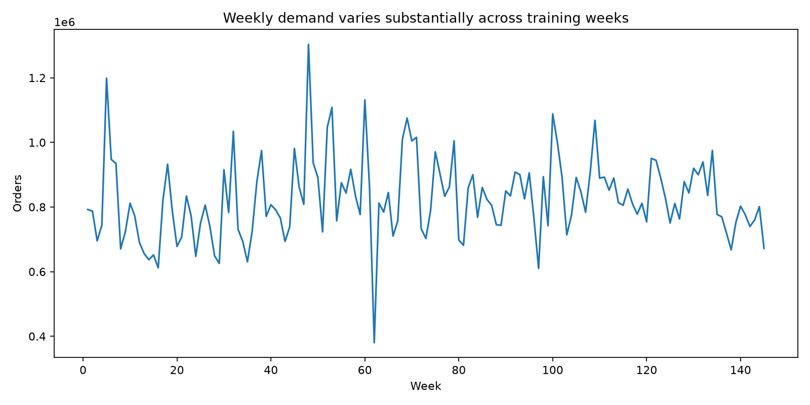
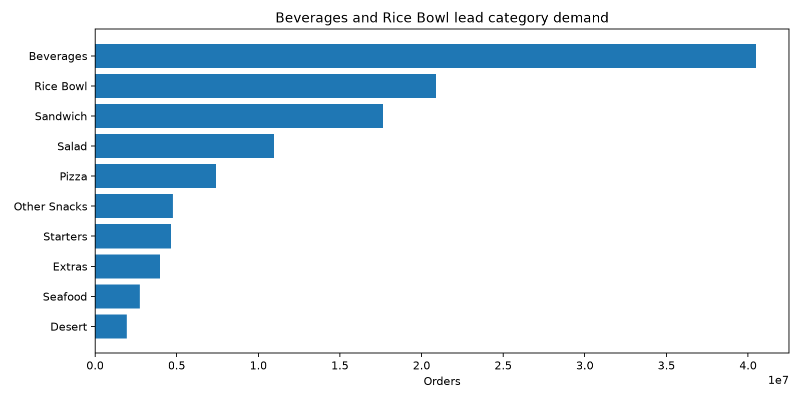
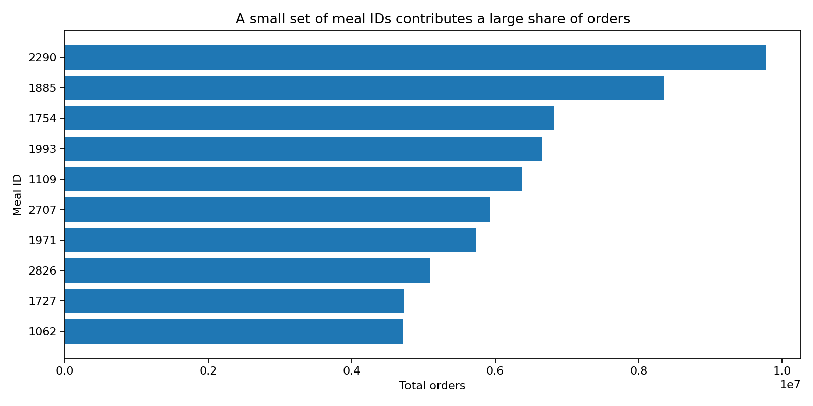
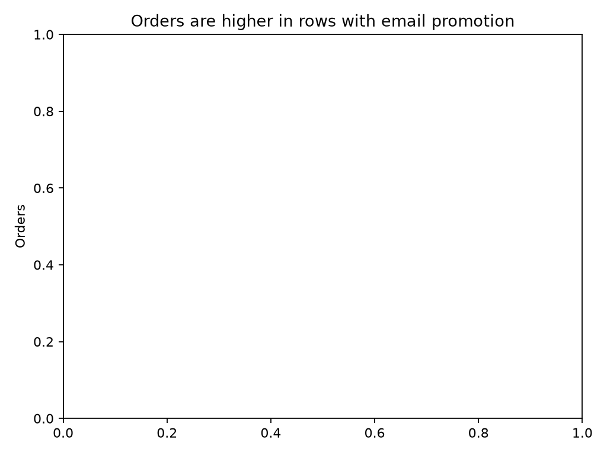
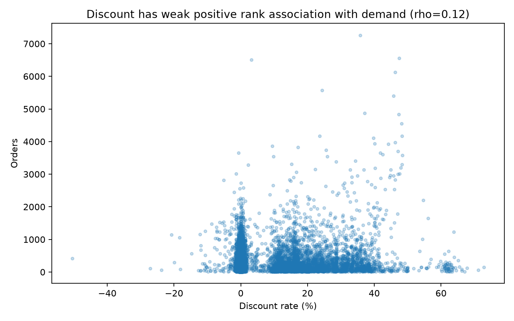
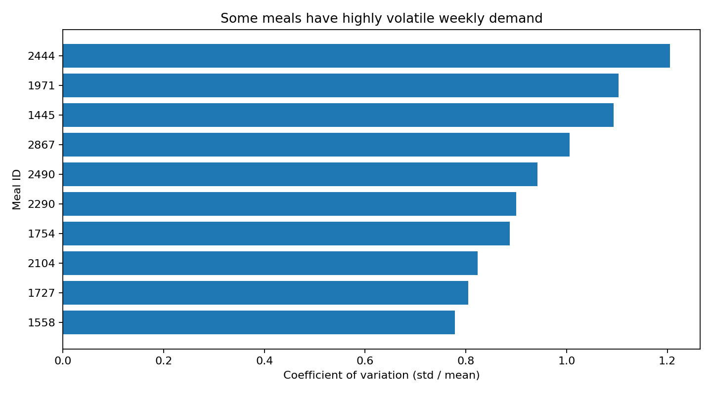

# تقرير العميل: تحليل الطلب لشركة توصيل وجبات

## ملخص تنفيذي
1. يحتوي ملف التدريب على **456,548 صفًا** عبر الأسابيع 1–145، بإجمالي **119,557,485 طلبًا**.
2. سجلت الفئة الأعلى طلبًا **Beverages** بعدد **40,480,525** طلبًا (33.9% من الطلبات)، تليها **Rice Bowl** بنسبة 17.5%.
3. بلغ متوسط الطلب الأسبوعي **824,534**؛ وكان أدنى أسبوع هو 62 (380,065) وأعلاه الأسبوع 48 (1,303,457).
4. ارتبطت صفوف البريد الترويجي بمتوسط أعلى للطلبات بنسبة **147.8%**، وارتبط الظهور في الصفحة الرئيسية بفرق **146.5%**؛ لكن هذه مقارنات رصدية وليست إثباتًا للسببية.
5. معامل ارتباط Spearman بين معدل الخصم والطلب هو **ρ=0.122** (p<0.001)؛ العلاقة موجبة لكنها ضعيفة، ولا تثبت أن الخصم وحده رفع الطلب.

## 1. تغير الطلب أسبوعيًا
إجمالي الطلبات يتغير بوضوح من أسبوع لآخر. المتوسط 824,534 طلبًا في الأسبوع. أدنى قيمة في الأسبوع 62 (380,065) وأعلى قيمة في الأسبوع 48 (1,303,457). لا توجد تواريخ تقويمية فعلية، لذلك لا يجوز تفسير رقم الأسبوع على أنه شهر أو موسم محدد.



## 2. الفئات والوجبات التي تصنع معظم الطلب
أعلى فئة هي Beverages بإجمالي 40,480,525 (33.9%). الفئة الثانية Rice Bowl بإجمالي 20,874,063 (17.5%). أكبر وجبة منفردة حسب meal_id هي 2290، بإجمالي 9,770,303 طلبًا (8.2%).
تُظهر البيانات أن أول خمس فئات تمثل 81.4% من إجمالي الطلبات. راجع `category_metrics.csv` و`meal_metrics.csv` للتفاصيل الكاملة.





## 3. أداء المراكز ونوع المركز
أعلى مركز من حيث مجموع الطلبات هو المركز 13 من النوع TYPE_B، بمجموع 4,296,545 طلبًا. لا يعني مجموع الطلبات وحده أن المركز أكثر كفاءة؛ فالمراكز تختلف في مدة التغطية وحجم التشغيل ومساحة المنطقة. لذلك أُرفقت مقاييس إجمالي الطلب والإيراد ومتوسط الطلب لكل سجل، مع المقارنة حسب النوع في `center_type_metrics.csv`.

## 4. هل ترفع العروض الطلب؟
قارنت الاختبارات صفوف الوجبة نفسها في المركز نفسه، مع قصر المقارنة على أزواج (مركز، وجبة) التي ظهرت فيها حالة العرض والحالة غير المعروضة. استُخدم اختبار Mann–Whitney ثنائي الطرف:
- البريد الترويجي: متوسط الطلب في الصفوف المعروضة 631.1 مقابل 254.6 دون البريد؛ فرق نسبي 147.8%، p<0.001.
- الظهور في الصفحة الرئيسية: 594.9 مقابل 241.4؛ فرق نسبي 146.5%، p<0.001.
الفرق دال إحصائيًا عند الحدود التقليدية إذا كانت p أقل من 0.05، لكنه لا يثبت السببية. كما أن العروض قد تتزامن مع خصومات أو اختيارات تسويقية أخرى. تصميم اختبار عشوائي أو نموذج مضبوط بعوامل إضافية أقوى لتقدير الأثر السببي.



## 5. علاقة الخصم بالطلب
حُسب معدل الخصم = (السعر الأساسي − سعر البيع) ÷ السعر الأساسي. وبلغ ارتباط Spearman ρ=0.122 مع p<0.001. هذا يشير إلى علاقة رتيبة موجبة ضعيفة. يوجد 116,101 سجلًا يكون فيه سعر البيع أعلى من السعر الأساسي، لذلك احتُفظ بمعدل الخصم بإشارته السالبة بدل اعتبار كل هذه السجلات أخطاء تلقائيًا. وقد تتداخل الأسعار مع الترويج والوجبة والمركز.



## 6. الوجبات المتذبذبة وأولوية المخزون
حُسب معامل التذبذب لكل وجبة من مجموع طلباتها الأسبوعية المرصودة: الانحراف المعياري ÷ المتوسط. أعلى معامل تذبذب هو للوجبة 2444 (1.21)، ومتوسطها الأسبوعي 6,500 طلبًا. معامل مرتفع وحده لا يكفي لتحديد المخزون؛ لذا يجمع ملف `meal_variability.csv` بين ترتيب حجم الطلب وترتيب التذبذب للمساعدة في تحديد الأولويات. لا يمكن حساب كمية مخزون آمنة مباشرة دون بيانات مهلة التوريد، والهدر، وسعة التخزين، والمخزون الفعلي.



## توصيات عملية ومقاييس النجاح
1. **تجربة شراء أسبوعية قائمة على الطلب** للوجبات ذات الحجم المرتفع والتذبذب المرتفع، بدل الاعتماد على التقدير الشخصي. **مؤشر النجاح:** انخفاض نسبة الهدر ونسبة نفاد الوجبات أسبوعيًا مقارنة بخط أساس موثق.
2. **اختبار مضبوط للعروض** على مجموعات متقاربة من المركز والوجبة والسعر، لأن الفروق الرصدية كبيرة لكنها لا تثبت السببية. **مؤشر النجاح:** الزيادة الصافية في الطلب والإيراد والهامش مقارنة بمجموعة ضابطة.
3. **مراجعة الفئات الأعلى طلبًا أولًا**، خصوصًا Beverages وRice Bowl اللتين تمثلان معًا 51.3% من الطلب. **مؤشر النجاح:** انخفاض حالات نفاد الأصناف الأعلى طلبًا دون زيادة الهدر.
4. **مراجعة السجلات ذات السعر فوق السعر الأساسي** وعددها 116,101 لتحديد هل هي تغييرات سعرية مشروعة أم أخطاء تعريف/بيانات. **مؤشر النجاح:** توثيق 100% من الحالات وتصحيح الأخطاء المؤكدة فقط.

## جودة البيانات وقرارات التنظيف
- دمج ملفات التدريب والوجبات والمراكز حافظ على عدد الصفوف: 456,548 قبل الربط وبعده.
- مجموع الطلبات لم يتغير: 119,557,485 قبل الربط وبعده.
- القيم المفقودة في ملف التدريب: 0; الصفوف المكررة تمامًا: 0.
- سجلت 116,101 حالة سعر بيع أعلى من السعر الأساسي. لم تُحذف آليًا لأن ذلك قد يعكس تسعيرًا مشروعًا.
- الأسابيع غير الموجودة لوجبة/مركز لا تُملأ بصفر تلقائيًا؛ غياب السجل لا يثبت أن الطلب كان صفرًا.
- ملفات المصدر الأصلية محفوظة كما هي داخل `data/raw/`، ويجب عدم تعديلها أو رفعها إلى مستودع عام.

## حدود التحليل
- أرقام الأسابيع ليست تواريخ تقويمية، والمدن ممثلة برموز.
- البيانات رصدية؛ الارتباط والفروق الإحصائية لا تثبت السببية.
- العروض والخصومات قد تحدث معًا، ما يصعب فصل أثر كل منهما.
- لا تتضمن البيانات المخزون الفعلي أو الهدر أو مهلة التوريد، فلا يمكن تقدير كميات الشراء المثلى مباشرة.
- `test.csv` لا يحتوي على `num_orders`؛ يستخدم فقط للتنبؤ الاختياري وليس لحساب دقة التنبؤ دون تسميات حقيقية.

## طريقة التشغيل
من مجلد المشروع:
```bash
pip install -r requirements.txt
jupyter notebook notebooks/analysis.ipynb
```
شغّل الخلايا بالترتيب. سيُنشئ التحليل الجداول والرسوم داخل `reports/`.


## إضافة اختيارية: التنبؤ بالطلب وتقييم النموذج

### المنهجية
تم حجز الأسابيع العشرة الأخيرة من بيانات التدريب (136–145) للاختبار الزمني. دُرّب نموذج Random Forest على الأسابيع السابقة فقط، مع تحويل الهدف باستخدام `log1p` ثم إعادة التنبؤ إلى مقياس عدد الطلبات. ولتوفير وقت التنفيذ على الحواسيب الشخصية، استخدم التدريب عينة عشوائية ثابتة تصل إلى 120,000 صف في التقييم، ثم عينة تصل إلى 150,000 صف لتدريب النموذج المستخدم في `test.csv`.

### النتائج
- MAE لنموذج Random Forest: **95.138** طلب.
- MAE لخط الأساس (طلب الأسبوع السابق لنفس المركز والوجبة، مع استخدام متوسطات بديلة عند غياب السجل): **92.939** طلب.
- تغير MAE مقارنة بخط الأساس: **-2.37%**.

**التفسير:** في هذا الاختبار الزمني، كان خط الأساس أفضل من نموذج Random Forest؛ لأن MAE الأقل أفضل. هذه نتيجة مهمة وليست فشلًا: فهي تمنعنا من الادعاء بأن نموذج التعلم الآلي يحسن التنبؤ قبل أن يثبت ذلك. يمكن لاحقًا تجربة ميزات زمنية إضافية، أو ضبط النموذج، أو اختبار نموذج آخر على نفس تقسيم الأسابيع.

### تنبؤات ملف الاختبار
أُنشئ الملف `reports/test_predictions.csv` ويحتوي على `id` و`num_orders` المتنبأ بهما لعدد **32,573** صفًا من `test.csv`. هذه تنبؤات وليست أعدادًا فعلية مؤكدة. ولأن `test.csv` لا يحتوي على الهدف الحقيقي، لا يمكن حساب MAE لهذا الملف.

الرسم `reports/figures/ml_mae_comparison.png` يعرض مقارنة الخطأ بين الطريقتين.
